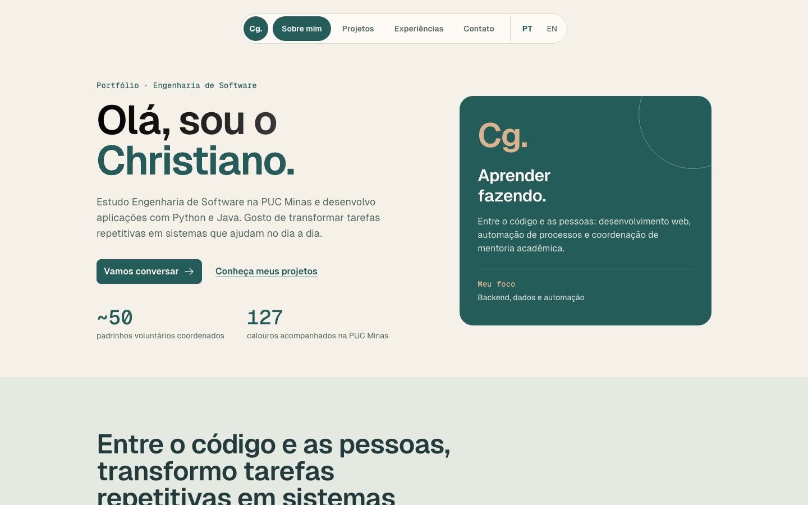
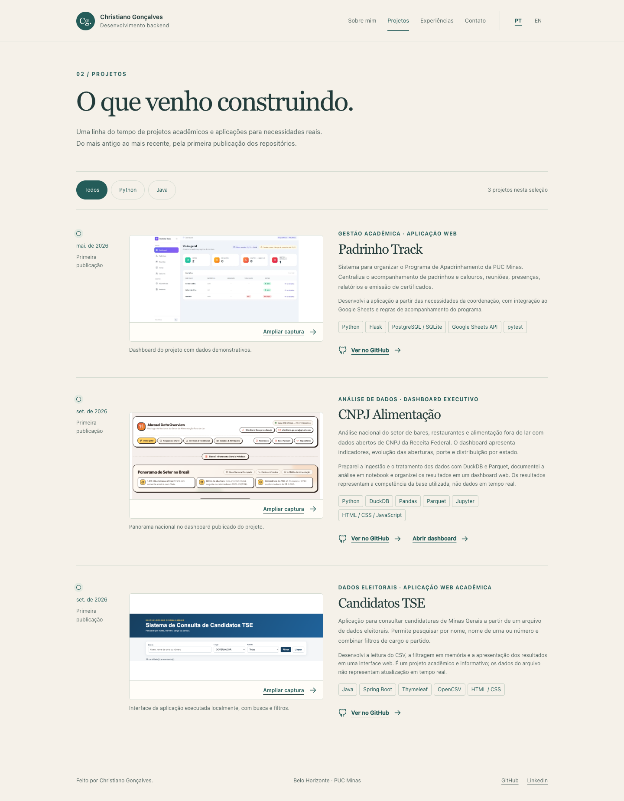
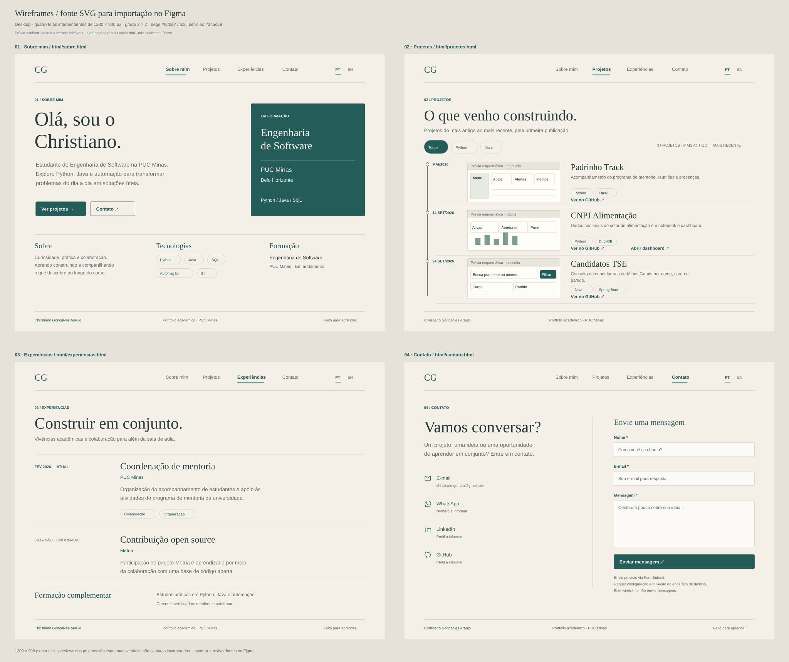

# Portfólio · Christiano Gonçalves

Portfólio profissional desenvolvido para o **Laboratório 01 de Desenvolvimento e Integração de Aplicações Web**, do curso de Engenharia de Software da PUC Minas.

A proposta é apresentar meus projetos, minha formação e experiências de forma direta, com navegação entre páginas, conteúdo em português e inglês e identidade visual em bege e azul-petróleo.

**[Acessar o portfólio](https://christiano-gonara.github.io/portfolio/)**

## Status do projeto

- Interface estática implementada com HTML, CSS e JavaScript em pastas separadas.
- Conteúdo de perfil, projetos e experiências em arquivos JSON.
- Capturas conferidas visualmente no desktop e no celular; sem suíte de testes automatizados, conforme o escopo combinado.
- Formulário **ativado no FormSubmit**, com envio realizado pelo site publicado e recebimento da mensagem confirmado pelo destinatário.
- Hospedagem: **GitHub Pages**, em <https://christiano-gonara.github.io/portfolio/>.
- Interface redesenhada com base na skill [landing-page-design](https://github.com/elayadesign/ai-design-skills), adaptada a um portfólio: uma só fonte, escala tipográfica fixa, espaçamentos e raios padronizados, movimento com curva própria, estados completos e páginas de apoio (404 e privacidade).
- Wireframes desktop e celular disponíveis em SVG. **Nenhum documento Figma foi incluído nesta versão; o enunciado da Sprint 01 solicita essa etapa.**

## Índice

- [Links úteis](#links-úteis)
- [Sobre o projeto](#sobre-o-projeto)
- [Funcionalidades principais](#funcionalidades-principais)
- [Tecnologias e dependências](#tecnologias-e-dependências)
- [Arquitetura](#arquitetura)
- [Instalação e execução](#instalação-e-execução)
- [Deploy](#deploy)
- [Estrutura de pastas](#estrutura-de-pastas)
- [Demonstração e wireframes](#demonstração-e-wireframes)
- [Conferência visual](#conferência-visual)
- [Documentações utilizadas](#documentações-utilizadas)
- [Autor](#autor)

## Links úteis

- [Repositório](https://github.com/christiano-gonara/portfolio)
- [Perfil no GitHub](https://github.com/christiano-gonara)
- [LinkedIn](https://www.linkedin.com/in/christiano-gonara/)

## Sobre o projeto

O site reúne minha apresentação, projetos e experiências acadêmicas, além de canais de contato. Ele usa páginas independentes para manter o código simples de entender e funciona em hospedagem estática.

O conteúdo pode ser atualizado sem alterar o layout: basta editar os arquivos da pasta `data/`.

### Decisões de interface

- **Legibilidade:** nenhum texto da interface abaixo de **14px** (medido no navegador nas seis páginas principais); corpo principal entre 16px e 18px. Todos os tamanhos seguem a escala do Tailwind (14, 16, 18, 20, 24, 30, 36, 48, 60 e 72px).
- **Tipografia:** **Gabarito** nos títulos, **Figtree** no texto e **JetBrains Mono** em datas, hospedadas no próprio repositório. Sem itálico e sem pesos acima de bold.
- **Espaçamento e cantos:** espaçamentos de uma lista fechada (2, 4, 8, 12, 16, 24, 32, 40, 48, 64, 80 e 96px) e raios do Tailwind. Elementos dentro de cards usam o raio do card menos o espaço entre eles.
- **Cor:** bege e azul petróleo, sem gradientes de fundo. O único gradiente é o do título principal da página inicial, aplicado só ao texto.
- **Affordance:** botões com aparência de botão, links sublinhados, ação explícita para ampliar capturas e botão principal único acima da dobra.
- **Gestalt:** informações relacionadas ficam próximas; projetos, experiências e formação usam cards com o mesmo formato, alinhamento e separadores.
- **Navegação:** pílula de vidro flutuante; no celular, o botão de menu vira um X e abre uma tela cheia com os links entrando em sequência. A página atual fica marcada.
- **Movimento:** transições com a curva `cubic-bezier(0.32, 0.72, 0, 1)`. Os blocos sobem e desfocam ao entrar na tela, usando `IntersectionObserver`, sem listener de scroll. A frase de destaque acende palavra por palavra ao rolar.
- **Ícones:** [Tabler Icons](https://tabler.io/icons) em SVG local, acompanhados de rótulos nas ações importantes. Ícones decorativos são ignorados por leitores de tela.
- **Estados:** hover, clique, foco visível, carregamento com esqueletos no formato do conteúdo, estado vazio nos filtros e erro de carregamento com botão para tentar de novo. Nenhum `alert()`.
- **Formulário:** validação no navegador com mensagens específicas por campo, botão desabilitado durante o envio e retorno ao estado normal ao voltar pelo histórico.
- **Acessibilidade:** link para pular ao conteúdo, alvos de pelo menos 44px, rótulos nos campos e respeito à preferência por movimento reduzido, que desativa animações e mostra tudo de imediato.

## Funcionalidades principais

| Página | Conteúdo |
|---|---|
| Sobre mim | Apresentação, formação, tecnologias e destaque do Padrinho Track. |
| Projetos | Bento grid com projeto em destaque, gerado a partir do JSON, filtros Python/Java, descrições, tecnologias, capturas e links dos repositórios. |
| Experiências | Mentoria acadêmica, contribuição open source e formação complementar. |
| Contato | Email com botão de copiar e atalhos para Gmail, Outlook e app de email; WhatsApp, LinkedIn e GitHub com o endereço visível; formulário com validação. |
| Gráficos | Barra empilhada das linguagens mais usadas e matriz de tecnologias por projeto (Sobre), em HTML e CSS, com dados dos JSON. |
| Privacidade e uso | O que o site guarda, como o formulário trata os dados, hospedagem e uso do conteúdo. |
| Página 404 | Página própria para endereços inexistentes, com caminho de volta ao início. |

A troca PT/EN traduz a interface e os dados. O idioma é mantido nos links internos e, quando permitido pelo navegador, no armazenamento local.

O projeto em destaque vem primeiro; os demais seguem pela data de primeira publicação, do mais antigo ao mais recente. Essa data não é apresentada como início do desenvolvimento.

### Formulário de contato

O `mailto:` abre o app padrão do sistema, que no Mac costuma ser o Mail e quase ninguém usa. Por isso o email aparece escrito, com botão de copiar (funciona em qualquer sistema) e atalhos para Gmail e Outlook na web. O `mailto:` fica como último atalho.

O formulário envia `name`, `email` e `message` por `POST` ao FormSubmit, que faz a verificação antispam e encaminha a mensagem ao e-mail do portfólio. Não existe simulação de envio por JavaScript.

A ativação deste portfólio foi concluída. O envio passou pela verificação antispam, retornou à página de agradecimento e a mensagem foi recebida no e-mail do destinatário.

Etapas de ativação inicial, mantidas como referência para uma nova configuração:

1. Acesse a página Contato, preferencialmente já publicada.
2. Preencha os campos e envie uma mensagem.
3. Conclua a verificação antispam do serviço.
4. Abra a mensagem de ativação recebida em `christiano.gonara@gmail.com` e confirme o formulário.
5. Confirme depois o recebimento de uma mensagem real. Até essa confirmação, não considere o envio validado.

O aviso abaixo do botão informa que os dados são processados por um serviço externo. O serviço pode mudar sua disponibilidade ou condições; e-mail direto e WhatsApp permanecem disponíveis como alternativas.

## Tecnologias e dependências

| Camada | Tecnologia | Papel |
|---|---|---|
| Estrutura | HTML5 | Páginas, navegação e formulário semântico. |
| Apresentação | CSS3 | Layout responsivo, tipografia, estados e identidade visual. |
| Comportamento | JavaScript com módulos nativos | Leitura dos JSONs, idioma, filtros e menu. |
| Conteúdo | JSON | Perfil, traduções, projetos e experiências. |
| Fontes | Gabarito, Figtree e JetBrains Mono (licença OFL), arquivos locais | Tipografia sem requisições a serviços de fontes. |
| Ícones | Tabler (licença MIT), SVG local | Ícones sem dependências externas. |
| Envio de e-mail | FormSubmit | Serviço externo para processar o formulário. |
| Hospedagem | GitHub Pages | Publicação dos arquivos estáticos. |

**Bibliotecas e frameworks em produção:** nenhum. Não há `npm install`, compilação, banco de dados, chave secreta ou servidor de aplicação.

**Para executar localmente:** navegador atualizado e Python 3 apenas para servir os arquivos por HTTP. Outro servidor estático também pode ser usado.

## Arquitetura

```text
Navegador
  ├── HTML + CSS + ícones locais
  ├── JavaScript → data/*.json
  └── Formulário POST → FormSubmit → e-mail do destinatário

GitHub Pages → entrega os arquivos estáticos
```

O `index.html` da raiz é apenas o ponto de entrada exigido pela hospedagem. Ele direciona para `html/sobre.html`; as páginas efetivas ficam todas em `html/`. O redirecionamento por JavaScript preserva idioma e fragmento da URL, com alternativa em HTML para acesso à página.

Os caminhos são relativos, para o site funcionar dentro de `/portfolio/` no GitHub Pages. Os JSONs são obtidos com `fetch`, por isso é necessário um servidor HTTP local em vez de abrir os arquivos com `file://`.

## Instalação e execução

```bash
git clone https://github.com/christiano-gonara/portfolio.git
cd portfolio
python3 -m http.server 8000
```

Acesse <http://localhost:8000/>. Para encerrar, pressione `Ctrl+C` no terminal.

### Atualização do conteúdo

| Arquivo | O que editar |
|---|---|
| `data/perfil.json` | Dados do perfil, tecnologias e textos PT/EN. |
| `data/projetos.json` | Projetos, datas de publicação, tecnologias, capturas e links. |
| `data/experiencias.json` | Experiências e formação complementar. |
| `css/style.css` | Cores, tamanhos, espaçamentos e comportamento responsivo. |
| `html/*.html` | Estrutura de cada página. |
| `js/app.js` | Carregamento e renderização dos dados, idioma e interações. |

Para adicionar um projeto, inclua um objeto em `data/projetos.json`, com os textos nas chaves `pt` e `en`, e coloque sua captura em `assets/projects/`. `publicadoEm` usa `AAAA-MM-DD`. A ordem da lista é calculada pelo JavaScript.

## Deploy

Configuração de publicação no GitHub:

1. Enviar os arquivos para a branch `main`.
2. Em **Settings → Pages**, escolher **Deploy from a branch**.
3. Selecionar **main** e **/ (root)**.
4. Aguardar o build do Pages e abrir o endereço do site.
5. Confirmar o carregamento do conteúdo, dos caminhos relativos e das imagens na publicação.

Não há etapa de build própria. `.nojekyll` informa que o conteúdo deve ser servido como arquivos estáticos. A cada novo push na branch configurada, o Pages pode gerar uma nova publicação.

## Estrutura de pastas

```text
portfolio/
├── index.html                 # Ponto de entrada da hospedagem
├── 404.html                   # Página para endereços inexistentes
├── html/
│   ├── sobre.html
│   ├── projetos.html
│   ├── experiencias.html
│   ├── contato.html
│   ├── privacidade.html
│   └── obrigado.html          # Retorno do serviço de formulário
├── css/
│   └── style.css
├── js/
│   ├── app.js
│   └── entrada.js
├── data/
│   ├── perfil.json
│   ├── projetos.json
│   └── experiencias.json
├── assets/
│   ├── favicon.svg
│   ├── og-image.png           # Imagem de compartilhamento
│   ├── fonts/                 # Gabarito, Figtree e JetBrains Mono
│   └── projects/              # Capturas reais dos projetos
├── docs/
│   ├── capturas/              # Imagens da interface implementada
│   └── wireframes/            # SVGs para importar no Figma
├── .gitignore
├── .nojekyll
└── README.md
```

## Demonstração e wireframes

### Interface implementada

| Sobre mim | Projetos |
|---|---|
|  |  |

[Captura da página Contato no celular](docs/capturas/contato-mobile.png).

Os projetos apresentados são Padrinho Track, CNPJ Alimentação e Candidatos TSE. A imagem do Padrinho Track foi obtida do repositório público; a do CNPJ Alimentação foi capturada do dashboard em seu design atual; a captura do Candidatos TSE foi feita com a aplicação executada localmente. O dashboard do Padrinho Track contém registros demonstrativos, não dados dos participantes do programa. Os projetos de dados refletem os arquivos utilizados, não atualizações em tempo real.

### Wireframes

- [Desktop: quatro telas](docs/wireframes/desktop.svg)
- [Celular: quatro telas](docs/wireframes/mobile.svg)



Arraste os SVGs para o canvas de um arquivo Figma. Confira se os elementos foram importados e continuam editáveis, organize os frames e adicione as conexões de navegação na aba Prototype. Compartilhe o link do arquivo com permissão de visualização.

**Figma não incluído nesta versão.** Os arquivos entregues são fontes vetoriais em SVG; não há afirmação de que um documento Figma já foi criado.

## Conferência visual

Foram abertas as páginas no navegador e registradas capturas em desktop e celular, incluindo o menu em tela cheia, o formulário com erros de validação, a troca para inglês e a página 404. Uma medição no navegador mostrou fonte mínima de **14px** nas seis páginas principais e largura da página igual ao viewport em **1440px** e **500px**. A largura de 390px não pôde ser medida desta forma, mas o layout foi conferido visualmente na captura de celular.

As animações de entrada foram verificadas em execução real e também com a preferência por movimento reduzido ativada. Não há suíte de testes automatizados. O formulário foi conferido separadamente por envio real, antes desta mudança visual: ativação e CAPTCHA concluídos pelo responsável, redirecionamento à página de agradecimento e recebimento confirmado pelo destinatário. Depois do redesenho, a validação foi testada no navegador, mas **não foi feito um novo envio real**.

## Documentações utilizadas

- [Enunciado e materiais da disciplina](https://github.com/joaopauloaramuni/desenvolvimento-e-integracao-de-aplicacoes-web)
- [Modelo de README indicado no laboratório](https://github.com/joaopauloaramuni/desenvolvimento-e-integracao-de-aplicacoes-web/blob/main/TEMPLATES/template_README.md), adaptado às camadas efetivamente utilizadas.
- [Skill landing-page-design](https://github.com/elayadesign/ai-design-skills/blob/main/skills/landing-page-design/SKILL.md), usada como guia do sistema visual
- [Gabarito](https://github.com/naipefoundry/gabarito), [Figtree](https://github.com/erikdkennedy/figtree), [JetBrains Mono](https://github.com/JetBrains/JetBrainsMono) e [Tabler Icons](https://github.com/tabler/tabler-icons)
- [GitHub Pages](https://docs.github.com/en/pages/getting-started-with-github-pages/creating-a-github-pages-site)
- [FormSubmit](https://formsubmit.co/documentation)
- [Padrinho Track](https://github.com/christiano-gonara/padrinho-track)
- [CNPJ Alimentação](https://github.com/christiano-gonara/cnpj-alimentacao)
- [Candidatos TSE](https://github.com/christiano-gonara/candidatosTSE)

## Autor

**Christiano Gonçalves Araújo** · Engenharia de Software, PUC Minas.

[GitHub](https://github.com/christiano-gonara) · [LinkedIn](https://www.linkedin.com/in/christiano-gonara/) · [E-mail](mailto:christiano.gonara@gmail.com)

## Contribuição

Para propor ajustes, abra uma Issue ou um Pull Request com escopo claro. Mensagens de commit seguem Conventional Commits em português.

## Agradecimentos e licença

Atividade orientada pelo Prof. João Paulo Carneiro Aramuni. Estrutura documental adaptada do template indicado na disciplina, sem incorporar tecnologias ou serviços que não são usados neste projeto.

Material acadêmico e pessoal. Nenhuma licença de redistribuição foi definida para este repositório.
