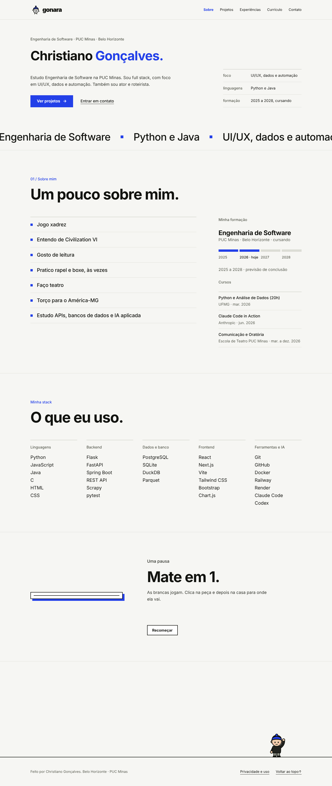
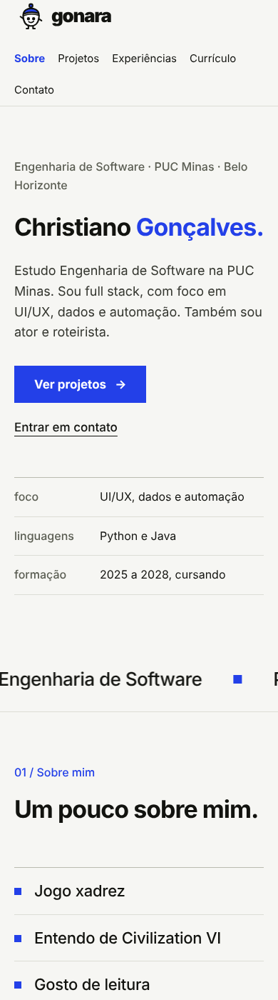

# Portfólio · Christiano Gonçalves (gonara)

Portfólio pessoal, criado no **Laboratório 01 de Desenvolvimento e Integração de Aplicações Web** do curso de Engenharia de Software da PUC Minas e redesenhado em novembro de 2026.

**[Acessar o portfólio](https://christiano-gonara.github.io/portfolio/)**

| Desktop | Celular |
|---|---|
|  |  |

## Status do projeto

- Site estático em HTML, CSS e JavaScript, com o CSS e o JS em pastas separadas das páginas.
- Hospedado no **GitHub Pages**, a partir da branch `main`, pasta raiz.
- Formulário de contato pelo **FormSubmit**, já ativado na versão anterior. Depois do redesenho não foi feito um novo envio real.
- Conteúdo só em português. A troca PT/EN da versão anterior saiu neste redesenho.
- Sem testes automatizados. As páginas foram conferidas por capturas no Chrome, em desktop e celular.

## Páginas

| Página | Conteúdo |
|---|---|
| Sobre (início) | Apresentação, faixa de frases em movimento, interesses pessoais, formação, cursos, stack e um desafio de xadrez “mate em 1”. |
| Projetos | CNPJ Alimentação, Padrinho Track, Hackathon Localiza, MinhaReceita e Candidatos TSE, com captura ou ilustração em moldura. |
| Experiências | Mentoria acadêmica na PUC Minas, contribuição no Metria e a peça O Minotauro (Dédalo). |
| Currículo | O PDF do currículo embutido na página, com botões para baixar e abrir em nova aba. |
| Contato | Email, WhatsApp, LinkedIn e GitHub com o endereço visível, mais o formulário. |
| Privacidade, Obrigado e 404 | Páginas de apoio. |

## Decisões de interface

- **Visual:** tema claro, fonte Roboto, um único acento azul-cobalto (`#2340E8`), cantos retos e linhas finas no lugar de cards.
- **Marca:** o apelido **gonara** como logo, com um mascote desenhado em traço de desenho infantil. Ele dá um pulinho quando o mouse passa por cima.
- **Bonequinhos:** cada página tem um bonequinho diferente em pé sobre a linha do rodapé.
- **Molduras:** capturas, ilustrações e o currículo ficam numa moldura branca com borda preta e sombra azul deslocada, levemente inclinada.
- **Movimento:** a faixa e o mascote param quando o sistema pede movimento reduzido.
- **Acessibilidade:** link para pular ao conteúdo, alvos de pelo menos 44px, rótulos nos campos, mensagens de erro por campo e textos alternativos nas imagens.

## Tecnologias

| Camada | Tecnologia |
|---|---|
| Estrutura | HTML5 |
| Estilo | CSS3 (`css/style.css`) |
| Comportamento | JavaScript com módulo nativo (`js/app.js`): xadrez e validação do formulário |
| Fonte | Roboto, pelo Google Fonts |
| Formulário | FormSubmit |
| Currículo | LaTeX (`assets/curriculo.tex`), compilado com XeLaTeX |
| Hospedagem | GitHub Pages |

Sem framework, sem build e sem dependências instaladas.

## Executar localmente

```bash
git clone https://github.com/christiano-gonara/portfolio.git
cd portfolio
python3 -m http.server 8000
```

Acesse <http://localhost:8000/>.

## Atualizar o currículo

```bash
cd assets
xelatex curriculo.tex
mv curriculo.pdf curriculo-christiano-goncalves.pdf
pdftoppm -png -r 130 -singlefile curriculo-christiano-goncalves.pdf pagina   # imagem de reserva
```

A imagem `curriculo-pagina-1.webp` aparece quando o navegador não consegue mostrar o PDF dentro da página (comum no celular).

## Estrutura de pastas

```text
portfolio/
├── index.html                  # Ponto de entrada, redireciona para html/sobre.html
├── 404.html
├── html/                       # sobre, projetos, experiencias, curriculo, contato, privacidade, obrigado
├── css/style.css
├── js/
│   ├── app.js                  # Xadrez e formulário
│   └── entrada.js              # Redirecionamento da raiz
├── assets/
│   ├── favicon.svg
│   ├── og-image.png
│   ├── curriculo-christiano-goncalves.pdf
│   ├── curriculo-pagina-1.webp
│   ├── curriculo.tex
│   ├── projetos/               # Capturas dos projetos e desenho de O Minotauro
│   └── ilustracoes/            # Ilustrações do Padrinho Track e do Candidatos TSE
└── docs/
    ├── capturas/
    └── wireframes/             # Wireframes da primeira versão
```

## Documentações utilizadas

- [Enunciado e materiais da disciplina](https://github.com/joaopauloaramuni/desenvolvimento-e-integracao-de-aplicacoes-web)
- [GitHub Pages](https://docs.github.com/en/pages/getting-started-with-github-pages/creating-a-github-pages-site)
- [FormSubmit](https://formsubmit.co/documentation)
- [Roboto no Google Fonts](https://fonts.google.com/specimen/Roboto)

## Autor

**Christiano Gonçalves Araújo** · Engenharia de Software, PUC Minas.

[GitHub](https://github.com/christiano-gonara) · [LinkedIn](https://www.linkedin.com/in/christiano-gonara/) · [E-mail](mailto:christiano.gonara@gmail.com)

## Licença

Atividade orientada pelo Prof. João Paulo Carneiro Aramuni. Material acadêmico e pessoal, sem licença de redistribuição definida.
